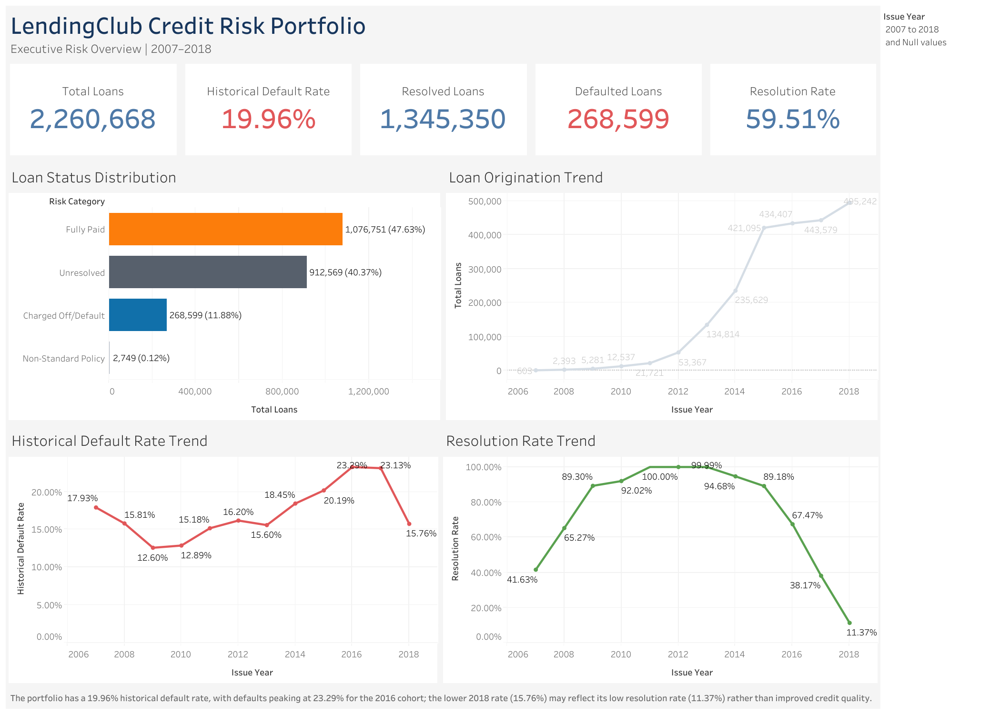
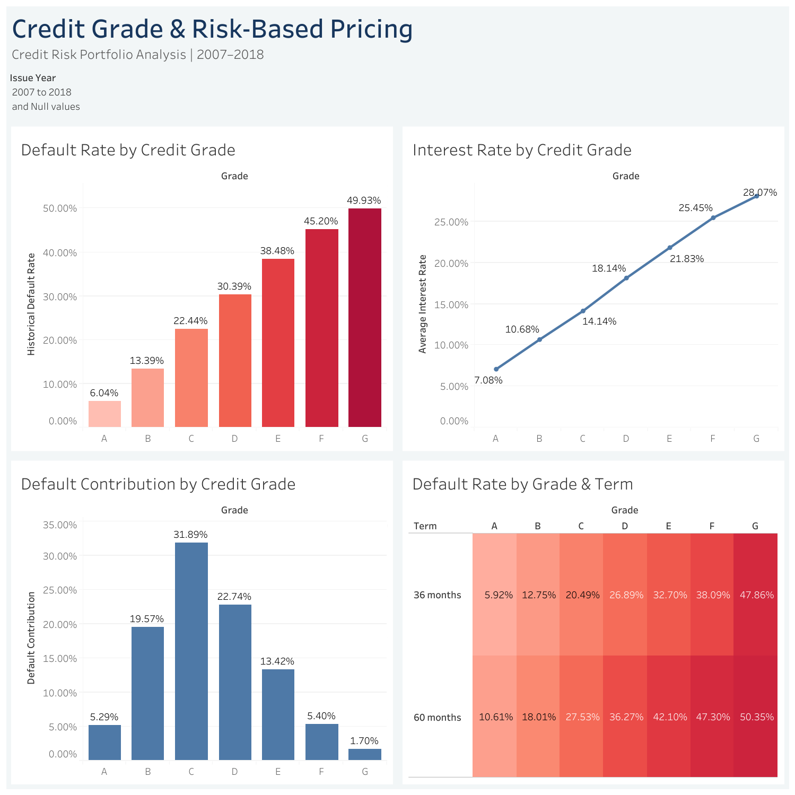
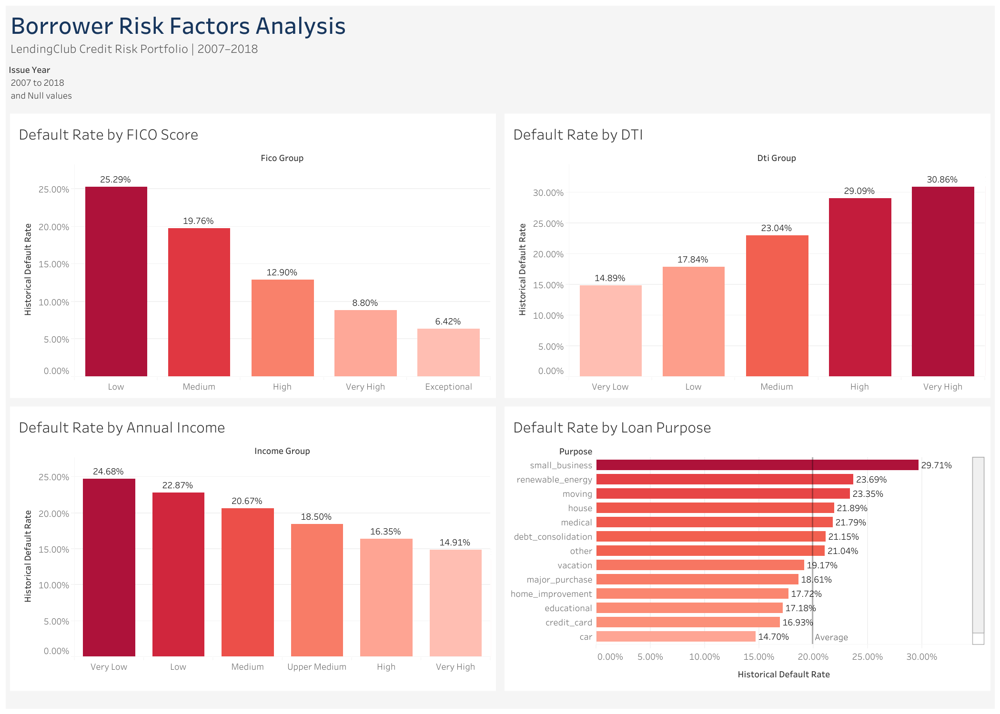

# LendingClub Credit Risk Portfolio Analysis

**SQL | MySQL | Tableau | Credit Risk Analytics**

## Project Overview

This independent portfolio project analyzes historical credit performance across 2.26 million LendingClub loans originated between 2007 and 2018. It examines credit grade differentiation, risk-based pricing, default concentration, borrower characteristics and origination cohort performance to support portfolio monitoring and risk management decisions.

## Key Portfolio Metrics

| Metric | Result |
|---|---:|
| Cleaned loans | 2,260,668 |
| Resolved loans | 1,345,350 |
| Observed defaults (Charged Off or Default) | 268,599 |
| Historical default rate among resolved loans | 19.96% |
| Resolution rate | 59.51% |
| Analytical fields | 27 |

## Business Questions

- How effectively do credit grades differentiate historical credit risk?
- Are higher-risk grades associated with higher interest rates?
- Which segments contribute most to observed defaults?
- How are loan term, FICO, income, DTI and loan purpose associated with credit outcomes?
- How does observed performance vary across origination cohorts?

## Data and Analytical Workflow

The source is the LendingClub accepted-loan dataset (`accepted_2007_to_2018Q4.csv`). The exact download source and redistribution license should be confirmed before sharing source records.

1. Imported 17 selected fields from the 151-column source into MySQL.
2. Removed 33 nonqualifying records using positive loan amount and numeric ID checks; validated 2,260,668 unique loan IDs.
3. Standardized loan status classifications and checked field quality.
4. Used SQL aggregations, CTEs, CASE expressions and window functions to analyze risk segments and cohorts.
5. Created a reusable analytical view with 10 derived fields, bringing the total to 27.
6. Exported and validated the analytical dataset for Tableau; developed three dashboards with year filters.

## Dashboard 1 — Executive Risk Overview



The dashboard summarizes portfolio size, observed defaults, resolution rates, loan status distribution and annual origination trends.

**Key insight:** The 2016 cohort had a historical default rate of 23.29%. The 2018 cohort had a lower observed rate of 15.76%, but only 11.37% of its loans were resolved. These rates should not be interpreted as directly comparable measures of lifetime risk.

## Dashboard 2 — Credit Grade & Risk-Based Pricing



| Grade | Historical default rate | Average interest rate | Default contribution |
|---|---:|---:|---:|
| A | 6.04% | 7.08% | 5.29% |
| B | 13.39% | 10.68% | 19.57% |
| C | 22.44% | 14.14% | 31.89% |
| D | 30.39% | 18.14% | 22.74% |
| E | 38.48% | 21.83% | 13.42% |
| F | 45.20% | 25.45% | 5.40% |
| G | 49.93% | 28.07% | 1.70% |

- Historical default rates increase monotonically across grades A–G, indicating descriptive risk differentiation.
- Average interest rates also increase across grades, consistent with risk-based pricing but not evidence of profitability.
- Grades C and D account for 54.63% of observed defaults, illustrating why default frequency and concentration should be monitored together.
- The observed default rate for 60-month loans is 32.45%, compared with 16.00% for 36-month loans. Longer-term loans show higher observed rates within each grade.

## Dashboard 3 — Borrower Risk Factors Analysis



| Risk dimension | Observed finding |
|---|---|
| FICO | Default rates decline from 25.29% in the Low group to 6.42% in the Exceptional group. |
| DTI | Default rates increase from 14.89% in the Very Low group to 30.86% in the Very High group. |
| Annual income | Default rates decline from 24.68% in the Very Low group to 14.91% in the Very High group. |
| Loan purpose | Small business loans have a 29.71% observed default rate; debt consolidation contributes approximately 61.44% of observed defaults. |

The Very Low FICO group contains only two resolved loans and is excluded from the dashboard comparison. Segment thresholds are project-defined, not underwriting standards.

## Risk Management Recommendations

- **Portfolio concentration:** Prioritize monitoring of grades C and D and debt consolidation loans alongside high-default-rate segments.
- **Underwriting review:** Investigate high-DTI and lower-FICO segments using multivariate analysis before proposing policy changes.
- **Loan term:** Evaluate longer-term loans within comparable origination cohorts and borrower profiles.
- **Pricing:** Assess whether interest income compensates for credit losses, funding costs and operating costs before drawing profitability conclusions.
- **Cohort monitoring:** Develop fixed-horizon performance measures when sufficiently detailed loan performance histories become available.

These are proposed analytical follow-ups, not validated lending policy changes.

## Metric Definitions and Limitations

- Historical default rate = observed defaults / resolved loans. Resolved loans are those classified as Fully Paid, Charged Off or Default; non-standard policy statuses are excluded from this denominator.
- Resolution rate = resolved loans / all cleaned loans.
- Default contribution = segment defaults / total defaults within the analyzed population.
- Average interest rates use loans with valid interest rates, not just resolved loans.
- Historical default rates are not forward-looking probability of default (PD) estimates. Unresolved loans and unequal observation periods introduce selection and maturity limitations.
- The analysis is descriptive, not causal; no predictive model, fixed-horizon vintage analysis, LGD, EAD or expected loss model is claimed.
- Original loan principal is not current exposure. Recoveries and principal repayments are post-origination variables and would create leakage in an origination-time predictive model.

## Repository Structure

```text
LendingClub-Credit-Risk-Portfolio/
├── README.md
├── .gitignore
├── sql/
│   ├── 01_database_setup.sql
│   ├── 02_data_import.sql
│   ├── 03_data_cleaning.sql
│   ├── 04_data_validation.sql
│   ├── 05_portfolio_overview.sql
│   ├── 06_credit_grade_and_pricing.sql
│   ├── 07_borrower_risk_analysis.sql
│   ├── 08_origination_cohort_analysis.sql
│   ├── 09_final_analysis_view.sql
│   ├── 10_final_data_validation.sql
│   └── 11_tableau_data_export.sql
├── tableau/
│   └── images/
│       ├── 01_executive_risk_overview.png
│       ├── 02_credit_grade_and_pricing.png
│       └── 03_borrower_risk_factors.png
└── docs/
    ├── data_dictionary.md
    └── methodology.md
```

## Reproduction Guide

Use MySQL 8.0+ and Tableau. Obtain the source CSV separately, configure the local import path and enable local infile access where permitted. Execute scripts 01–11 in order against a fresh project schema. Validate the exported CSV's parsing, row count and field count before importing it into Tableau. The original analysis and dashboard metrics were validated during development; the reorganized SQL scripts have not been rerun end-to-end.

The source CSV, exported loan-level data and packaged Tableau workbook are intentionally excluded from the proposed public repository pending confirmation of redistribution rights. Dashboard screenshots document the visualization results.

## Documentation

- [Data Dictionary](docs/data_dictionary.md)
- [Analytical Methodology](docs/methodology.md)
